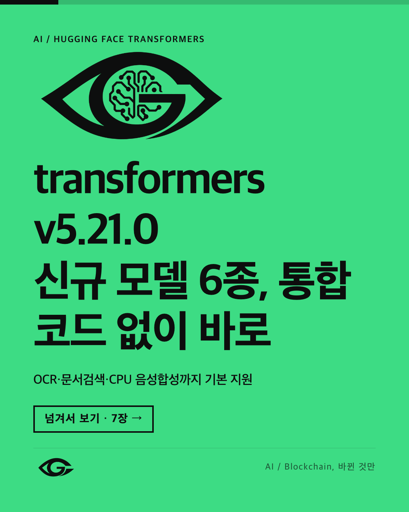
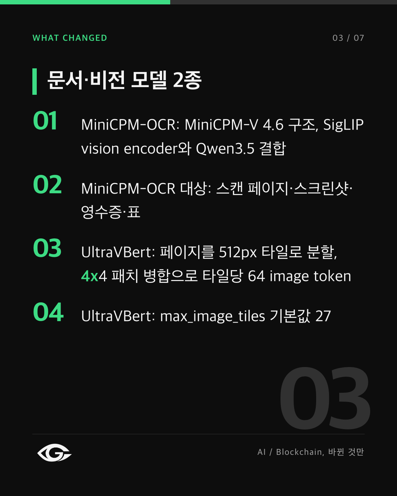
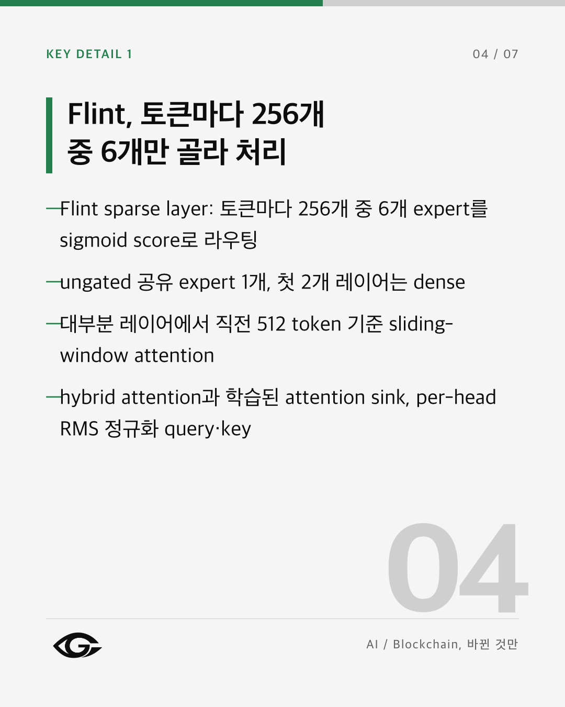
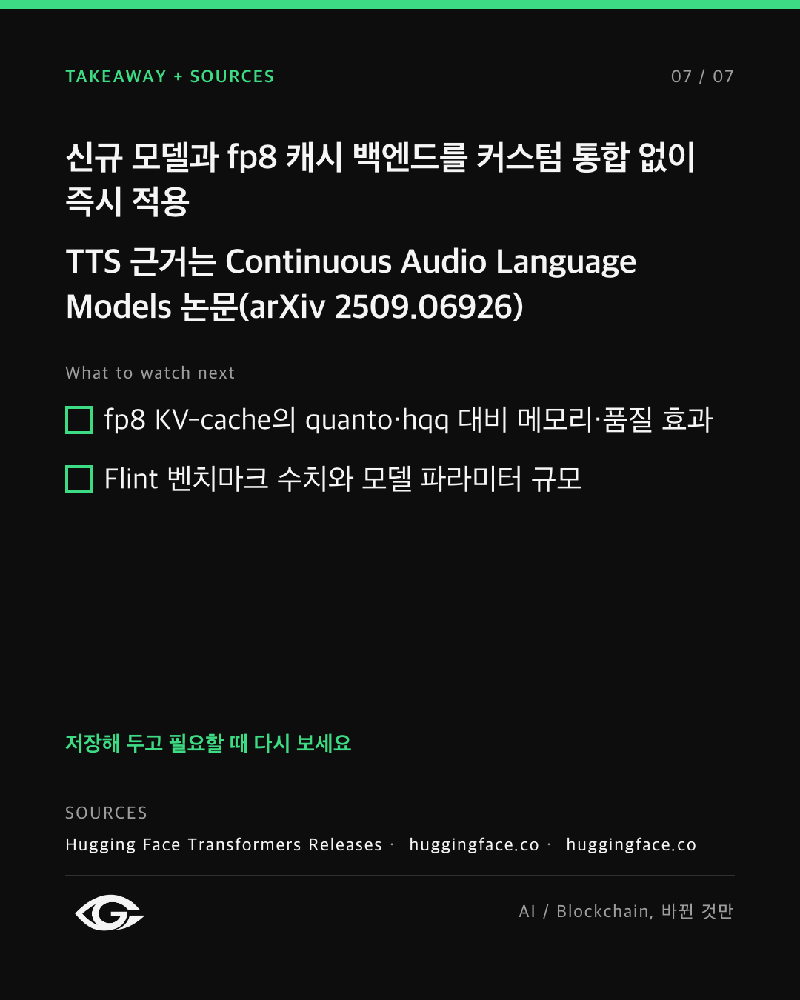

<div align="center">

# card-news-factory

**검증하는 AI 카드뉴스, 자동 운영.**<br>
수집 → 사실 검증 → 캐러셀 → 승인 게이트 → 인스타그램. AI는 글만 쓰고, 나머지는 모두 코드가 맡습니다.

[](https://github.com/Real-Woong/card-news-factory/actions/workflows/ci.yml)
[](LICENSE)


[English](README.md) · [소개 페이지](https://Real-Woong.github.io/card-news-factory/) · [운영 계정](https://www.instagram.com/r_a_glance/) · [구조](docs/ARCHITECTURE.md)

<br>

<table>
  <tr>
    <td></td>
    <td></td>
    <td></td>
    <td></td>
  </tr>
</table>

<sub>이 파이프라인이 실제로 게시한 카드입니다. 슬라이드는 HTML/CSS 템플릿으로 렌더링되고, 모델이 쓴 것은 카드 위의 글뿐입니다.</sub>

</div>

---

## 왜 만들었나

대부분의 "AI 콘텐츠 자동화"는 모든 걸 모델에 맡깁니다. 그러다 모델이 소스에 없던 날짜나 숫자, 근거보다 넓게 말하는 제목을
자신 있게 게시합니다. `card-news-factory` 는 한 가지 규칙으로 만들었습니다.

> **AI는 글만 씁니다. 레이아웃, 색, 승인, 게시는 코드가 정합니다.**

모델이 만든 문장은 모델을 믿지 않는 여러 겹을 통과해야 하고, 불확실하면 승인이 아니라 **보류**입니다. LLM 호출이 실패하면
가짜 문장으로 대신하지 않고 **실패로 끝납니다**. [@r_a_glance](https://www.instagram.com/r_a_glance/) 계정을 이 파이프라인이 운영합니다.

## 특징

- **검증이 먼저**: 슬라이드를 쓰기 전에 항목을 묶고 중복을 없애고 출처와 대조합니다.
- **여섯 겹**: 사실 검증 → 문장별 근거 추적 → 자동 수정 → 독립 심사관(심각도는 코드가 판정) → 승인 게이트 → 게시 직전 가드.
- **결정적인 디자인**: 번호 카드·타임라인·마무리 장·표지 채움·큰 수치 블록·용어 풀이·대비 계산·덱 전체 같은 글자 배율을 규칙으로 정합니다.
- **자기 수정**: 근거가 약한 문장은 근거 범위로 좁혀 다시 검사합니다. 새 숫자·URL은 코드가 거절합니다.
- **무인 운영**: 주간 일정, 일시정지 파일, 하루 상한, 토큰 자동 갱신, API 사전 점검, 다음 주제 대체, 휴대폰 알림(텔레그램).
- **작고 오프라인으로 테스트**: 핵심 의존성 5개, 네트워크 없이 도는 테스트 800개 이상.

## 빠른 시작 (API 키 없이)

Python 3.11+ 가 필요하고, PNG 렌더링에만 Chrome/Chromium 이 필요합니다.

```bash
git clone https://github.com/Real-Woong/card-news-factory.git && cd card-news-factory
python -m venv .venv && source .venv/bin/activate
pip install -r requirements.txt
make test        # 전부 오프라인
make run-dry     # 샘플 데이터와 mock LLM 으로 엔진 실행, 네트워크 없음
```

`run-dry` 는 엔진(수집→선별→research→fact-check)을 돌립니다. 엔진 초기의 X/LinkedIn 텍스트 초안도 같이 나오지만 유지보수 대상은 인스타그램 채널입니다.
샘플 카드 렌더링(Chrome 필요):

```bash
python -m channel.src.pipeline \
  --render-only tests/fixtures/channel/v2-case2-ai-standard/carousel.json \
  --output-dir ./out
open ./out/preview.html
```

> mock LLM 은 엔진 단계만 압니다. **새 카드를 만들려면 실제 LLM 제공자가 필요합니다.**

## 실제로 돌리기

1. `cp .env.example .env` 후 `LLM_PROVIDER`(`kiro_cli`·`openai`·`anthropic`)와 키를 넣습니다(`.env` 는 git 에서 제외됩니다).
2. `make run` 으로 수집·검증, `python -m channel.src.pipeline` 으로 카드 한 장을 만들어 게이트에 통과시킵니다.
3. `For_Review/<run>/preview.html` 로 확인하고 `python -m channel.src.approval approve <run>`.

`kiro_cli` 는 실제 운영에서 쓰고 있고, `openai`·`anthropic` 어댑터는 포함돼 있지만 검증이 덜 됐습니다.

내 브랜드로 바꾸려면 `channel/config/brand.yaml`(이름·태그라인·색·로고), `content.yaml`(글자 수·레이아웃·용어 풀이·품질 기준),
`instagram.yaml`(주기·게시 스위치·알림), `channel/prompts/*.md`(단계별 지시문)를 고칩니다. 예시 브랜드는 R_A_Glance 이고 `logo/` 에는 임시 로고가 있습니다.

## 자동 게시는 기본으로 꺼져 있습니다

`instagram.channel.phase: 3`, `publish: true`, `publishing.auto_publish: true`, 인스타그램 API 자격증명, JPEG 공개 호스팅(GitHub Pages 가능)이
모두 있어야 올라갑니다. 켜기 전에 [SECURITY.md](SECURITY.md) 를 읽으세요. 플랫폼 약관과 AI 생성물 관련 규정을 지킬 책임은 사용자에게 있습니다.
주간 일정은 `scripts/` 의 macOS `launchd` 작업(월 엔진, 수·일 게시)이고, 리눅스에서는 cron 이나 systemd 타이머로 같은 두 명령을 실행하면 됩니다.

## 로드맵

- [ ] 카테고리 확장(보안·정책·우주·바이오): 색과 로고는 있고 수집기가 다음 순서
- [ ] 리눅스 스케줄러 예시와 Docker 이미지
- [ ] 레이아웃 추가, OpenAI/Anthropic 제공자 테스트, 영어 샘플 카드

## 기여

이슈와 PR 을 환영합니다. [CONTRIBUTING.md](CONTRIBUTING.md) 에서 시작하세요. 테스트는 오프라인으로, 모델·네트워크·인스타그램 API 는 가짜로 대체합니다.

## 상태

어리지만 실제로 동작합니다. 라이브 계정에 게시한 적이 있고 주간으로 돌도록 설정돼 있습니다. 거친 부분이 있을 수 있으니 이슈로 알려 주세요.
한 명의 개발자가 Claude Code 와 함께 공개적으로 만들었습니다.

## 라이선스

[MIT](LICENSE)

<div align="center">

도움이 됐다면 스타 하나가 다른 사람이 찾는 데 도움이 됩니다. ⭐

</div>
