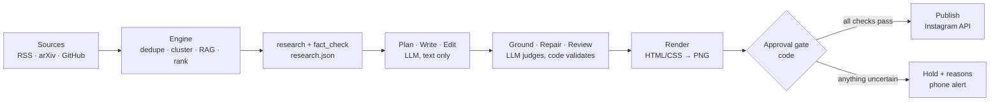

<div align="center">

# card-news-factory

**Verified AI card-news, on autopilot.**<br>
Collect → fact-check → carousel → approval gates → Instagram. The LLM writes the words; code owns everything else.

[](https://github.com/Real-Woong/card-news-factory/actions/workflows/ci.yml)
[](LICENSE)

[](CONTRIBUTING.md)

[Live demo](https://Real-Woong.github.io/card-news-factory/) · [Live account](https://www.instagram.com/r_a_glance/) · [Architecture](docs/ARCHITECTURE.md) · [한국어](README.ko.md)

<br>

<table>
  <tr>
    <td></td>
    <td></td>
    <td></td>
    <td></td>
  </tr>
</table>

<sub>Real output, posted by this pipeline. Slides are rendered from HTML/CSS templates; the text on them is the only thing a model wrote.</sub>

</div>

---

## Why this exists

Most "AI content automation" hands the whole job to a model and hopes. That works until it
confidently publishes a wrong date, a number that was never in the source, or a headline that
says more than the evidence does.

`card-news-factory` is built around one rule:

> **The LLM only writes text. Code decides layout, colors, approval and publishing.**

Everything a model produces has to get past layers that do not trust it, and anything uncertain
is **held, never approved**. If the LLM provider fails, the run fails loudly. There is no mock
fallback that could post made-up text.

It powers the [@r_a_glance](https://www.instagram.com/r_a_glance/) account: collecting, verifying,
rendering and posting on a weekly rhythm, without a human in the loop.

## Highlights

- **Verification first.** Items are clustered, de-duplicated and fact-checked against their
  sources before a single slide is written.
- **Six layers** between a model's sentence and a published post (below), none of which takes the model's word for it.
- **Deterministic design.** Layout, theme and emphasis come from rules, not from the model:
  numbered cards, timelines, takeaway slides, accent covers, big-number blocks, glossary
  lines, WCAG-checked contrast and a deck-wide uniform type scale.
- **Self-repair.** Weakly supported sentences are narrowed to what the evidence supports, then
  re-checked. New numbers, URLs and internal wording are rejected by code.
- **Unattended operation.** Weekly schedule, pause switch, daily cap, token refresh, API
  pre-checks, next-topic fallback and phone notifications.
- **Small and offline-testable.** Core dependencies are five packages. 800+ tests run without a network.

## How it works



| Layer | What it does |
|---|---|
| **Fact-check** | Verdict per topic (`verified`, `partially_verified`) with sources and unverified claims. Only `verified` is auto-approved. |
| **Grounding** | A judge rules on every sentence against the evidence. Code re-validates the judge: cited evidence must exist, missing verdicts count as *unchecked*. |
| **Auto-repair** | Weak sentences are narrowed or dropped. Code rejects any new number, URL or internal wording the model adds. |
| **Independent reviewer** | A second prompt hunts overclaims and contradictions between slides. **Severity is decided by code** from the issue kind, and quotes must exist on the card. |
| **Approval gate** | Verdict, claims, grounding, source relevance, quality score and blocking checks must all pass. |
| **Publisher guards** | Content-hash match, freshness, daily cap, pause file and an API pre-check. Ambiguous failures are never retried blindly. |

### Caught in production

| Stage | The model wrote | After the pipeline |
|---|---|---|
| Grounding → repair | "3 on-device TTS models added that run on CPU" | "Pocket TTS runs faster than real time on CPU" (only one model had that evidence) |
| Independent reviewer | Title: "3 voice models that run on CPU" | "Voice models that also run on CPU" (the count was not supported) |
| Source relevance | 9 of 10 attached sources were unrelated docs pages | Candidate held; the collector bug was fixed |
| Plain-language rule | Title: "Flint's MoE routing structure" | "Flint: 6 of 256 chosen per token" |

<sub>Examples translated from the original Korean cards.</sub>

## Quick start

You need Python 3.11+. Chrome or Chromium is only needed to render PNGs. **No API key is needed for this section.**

```bash
git clone https://github.com/Real-Woong/card-news-factory.git
cd card-news-factory
python -m venv .venv && source .venv/bin/activate
pip install -r requirements.txt

make test        # 800+ tests, fully offline
make run-dry     # engine on bundled sample data with a mock LLM, no network
```

`run-dry` exercises the engine (collect → rank → research → fact-check). It also writes text drafts
for the engine's original X/LinkedIn channels; the Instagram channel is the maintained path.

Render a bundled sample carousel (needs Chrome/Chromium):

```bash
python -m channel.src.pipeline \
  --render-only tests/fixtures/channel/v2-case2-ai-standard/carousel.json \
  --output-dir ./out
open ./out/preview.html        # xdg-open on Linux
```

> The mock provider only covers the engine. Generating a *new* carousel needs a real LLM provider (below).

## Run it for real

1. `cp .env.example .env` and set `LLM_PROVIDER` plus the matching key. Secrets live only in `.env`, which is git-ignored.
2. `make run` collects and verifies news (calls your LLM provider).
3. `python -m channel.src.pipeline` builds one card from the best verified topic and runs it through the gates.
4. Review `For_Review/<run>/preview.html`, then `python -m channel.src.approval approve <run>`.

| Provider | Status |
|---|---|
| Kiro CLI (`kiro_cli`) | Used in production |
| OpenAI (`openai`), Anthropic (`anthropic`) | Adapters included, less battle-tested |
| `mock` | Engine only, for tests and dry runs |

## Make it yours

| File | What to change |
|---|---|
| `channel/config/brand.yaml` | Name, tagline, palette, fonts, logos. The example brand is R_A_Glance; the repo ships generic placeholder logos in `logo/`. |
| `channel/config/content.yaml` | Text budgets, layout rules, glossary, plain-language rules, gate thresholds |
| `channel/config/instagram.yaml` | Posting rhythm, publishing switches, notifications |
| `config/sources.yaml`, `config/topics.yaml` | What to collect |
| `channel/prompts/*.md` | One instruction file per LLM step |

## Automatic posting is OFF by default

Posting needs all of: `instagram.channel.phase: 3`, `instagram.channel.publish: true`,
`instagram.publishing.auto_publish: true`, Instagram API credentials, and a public host for the
JPEGs (GitHub Pages works; see `channel/src/media.py`). None is on out of the box.

Read [SECURITY.md](SECURITY.md) before enabling it. You are responsible for following the
platform's terms and local rules on AI-generated content.

For a weekly rhythm there are macOS `launchd` jobs in `scripts/` (engine on Monday, posts on
Wednesday and Sunday). On Linux, use cron or a systemd timer to run the same two commands.

## Project layout

```
src/        engine: collect → normalize → dedupe → cluster → RAG → rank → research → fact_check
channel/    channel: plan → write → edit → ground → repair → review → render → gate → publish
config/     engine configuration            channel/config/   channel configuration
tests/      800+ offline tests              scripts/          launchd and helper scripts
docs/       architecture and demo page
```

`channel` depends on `src`, never the reverse. A test enforces it.

## Roadmap

- [ ] More categories (security, policy, science, health): colors and logos exist, collectors are next
- [ ] Linux scheduler recipe (cron / systemd) and a Docker image
- [ ] More layouts and a chart block for time series
- [ ] First-class OpenAI and Anthropic provider tests
- [ ] English sample cards and an English demo flow

## Contributing

Issues and pull requests are welcome. Start with [CONTRIBUTING.md](CONTRIBUTING.md). Good first
areas: a new category, a scheduler recipe, an LLM provider, a layout. Keep tests offline and use
fakes for the model, the network and the Instagram API.

## Status

Young but real: it has published to a live account and is configured to run weekly. Expect rough
edges, and open an issue when you hit one. It was built in public by one developer together with
Claude Code.

## License

[MIT](LICENSE). The placeholder logos in `logo/` are generated shapes you can replace freely.

<div align="center">

If this saves you time, a star helps others find it. ⭐

</div>
